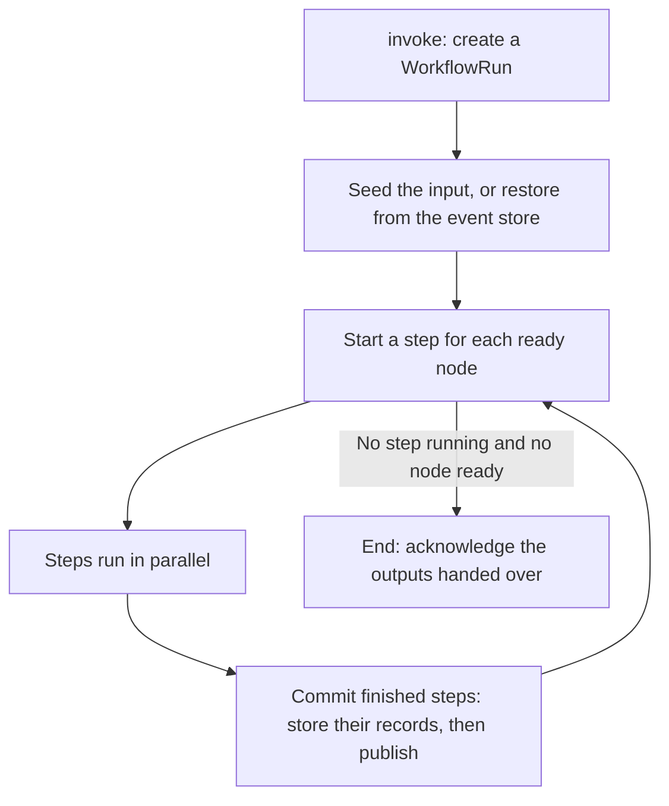

# Event-Driven Workflow

The event-driven workflow is the execution layer of Graphite. Nodes communicate
through topics with a publish/subscribe model: a node runs when the events on
its subscribed topics satisfy its subscription, and what it publishes can make
other nodes ready. Independent nodes run in parallel, every step is recorded in
the event store, and an unfinished request can be resumed from those records.

## Fields

The fields of the EventDrivenWorkflow are:

| Field Name          | Type                              | Description                                                                                           |
|---------------------|-----------------------------------|-------------------------------------------------------------------------------------------------------|
| `name`              | `str`                             | Unique identifier for the workflow instance (default: `"EventDrivenWorkflow"`).                       |
| `type`              | `str`                             | The type identifier for the workflow, typically matching the class name (`"EventDrivenWorkflow"`).    |
| `oi_span_type`      | `OpenInferenceSpanKindValues`     | Semantic attribute from OpenInference used for tracing and observability (default: `AGENT`).         |
| `workflow_id`       | `str`                             | Unique identifier for the workflow instance, auto-generated UUID.                                     |
| `nodes`             | `Dict[str, NodeBase]`             | Collection of all nodes defined within this workflow, keyed by node name.                             |
| `topics`            | `Dict[str, TopicBase]`            | Computed from the nodes: the topics they subscribe and publish to, by name, which the workflow saves and loads back before its nodes. |
| `_active_runs`      | `Dict[int, WorkflowRun]`          | The runs in flight, which `stop()` stops. (The inherited `_stop_requested` flag only records that `stop()` was called; runs do not read it.) |

The workflow is a *definition*. Each `invoke()` runs on its own
`WorkflowRun`, which holds all of that invocation's state, so concurrent
invocations of one workflow share no state but the registry of runs in flight
that `stop()` uses.

## Methods

| Method Name                      | Description                                                                                  |
|----------------------------------|----------------------------------------------------------------------------------------------|
| `model_post_init`                | Wires the workflow from its nodes (`_wire`), which checks them, and warns of a spec given to an LLM for a function a function-call node answers. |
| `_wire`                          | The workflow wired from its nodes as they are: its topics, each one's readers and each node's wiring, after checking the nodes' keys and subscriptions; as the workflow is built, and as each run starts. |
| `builder`                        | Class method that returns a WorkflowBuilder for fluent workflow construction.               |
| `_checked_topics`                | The workflow's topics and each one's readers, checked.                                       |
| `_wire_function_calls`           | Offers each LLM node the functions of the function-call nodes reading its calls, and has one function-call node on each topic carrying calls answer the calls there naming a function no LLM calling there was offered. |
| `invoke`                         | Runs the workflow on a new `WorkflowRun`, yielding its outputs as their steps commit, and, with `stream=True`, the deltas its tools emit. The run first wires the workflow from its nodes as they are now. |
| `offered_to`                     | The functions the LLM of a node is offered in its steps: those of the function-call nodes reading its calls, then those it is given. |
| `stop`                           | Stops every run in flight.                                                                   |
| `model_dump(mode="json")` / `model_validate` | Saves the workflow, with its nodes and topics, as data, and loads it back. See [Manifests](manifests.md). |

## Workflow Execution Flow

## Workflow Initialization

When an EventDrivenWorkflow instance is initialized, and as each run starts, `_wire` performs these setup tasks:

1. **Node Check**: Refuses a node keyed by another name, without a subscription, or whose subscriptions name other topics than when it was built
2. **Topic Setup** (`_checked_topics`): Constructs the workflow graph by analyzing each node's subscription expressions and publish destinations
3. **Function Calling Integration** (`_wire_function_calls`): Wires function-calling nodes to the LLM nodes calling them

The topic setup process:

- Collects the topics the nodes subscribe and publish to (`workflow.topics`), and
  each topic's readers, which `_wire` returns to the run (nothing is stored)
- Rejects a topic that overrides a method runs do not call, or that has a custom
  `event_queue` (see [Topic Base](topics/topic_base.md))
- Validates that required `InputTopic` and `OutputTopic` exist

For function calling capabilities:

- Identifies nodes using `FunctionCallTool`
- Offers their functions to each LLM node that publishes to a topic they read, or to an in-workflow output topic paired with a topic they read
- On each topic carrying LLM calls, the first function-call node reading it (preferring one with `on_error="return"`) also answers, with an error, the calls there naming a function no LLM calling there was offered, so that every call reaching a function-call node gets a result.

Each run works out this wiring as it starts, which nodes read each topic, the
functions each LLM node is offered and the calls each function-call node
answers, and binds each node's wiring to that node's steps (see `grafi.runtime.wiring`),
where only the node's tool, or a copy of it (same `tool_id`), reads it: the
LLM's `get_function_specs()`, the function-call command. So a workflow stores
none of it in the tools and nodes it shares with another workflow, or with a
copy of itself; a node added, removed, replaced or changed reaches the next
run, and a run in flight keeps the wiring it started with.
`workflow.offered_to(node_name)` says what an LLM node is offered.

A node's subscriptions are fixed when the node is built: to change them, build a
new node, with its builder or constructor. A run refuses a node whose
subscriptions name other topics than when it was built (changed in place, or
copied with `model_copy(update=...)`).

## How a Run Executes

A `WorkflowRun` executes one invocation with a single coordinator task that
starts and commits its steps. The run's state changes only in synchronous code
on the run's event loop, so the run needs no locks for it (one lock guards a
`stop()` from another thread before the run starts), and nothing polls.

### Readiness

Each topic of the run is a log of the publications made during the run, with a
read position per consumer. A node is **ready** when the topics it has unread
events on satisfy its subscription expression, and no step of the node is
running. The coordinator then takes all of the node's unread events (they become
the step's input) and starts a task for the step. A node runs one step at a time;
different nodes run in parallel.

Subscriptions combine topics with AND and OR:

- **AND**: the node runs once every topic in the expression has unread events.
- **OR**: the node runs as soon as any of them has. It receives everything unread
  on its subscribed topics at that moment, so the other topics' events may arrive
  in a later step.

### Step Commits

A node's invocation is one step. When steps finish, the coordinator commits
them: their consumption and publication records are written to the event store
in **one atomic batch**, and only then are their publications appended to their
topics, where they can make other nodes ready. No node ever consumes a
publication that a failure could lose, and topic positions are always
contiguous. Steps that finish together are committed in the same write.

Outputs reach the caller the same way: only once their step is stored. A caller
that streams the run (`invoke(..., stream=True)`) also gets the deltas each step
emits, such as an LLM's tokens, as they are emitted; deltas are never published
or stored (see [Runtime](runtime.md#streaming)). A node that should feed another
node item by item publishes each item from its own invocation, for example by
consuming a topic it publishes to.

### Ending a Run

A run ends when no step is running and no node is ready. This is exact:
an `A AND B` subscription whose `B` never arrives simply leaves the node
unready, and the run ends.

A run also stops early when:

- **a node fails**: as soon as the failure reaches the run, no new steps start,
  the other running steps are cancelled at once and awaited, and the failure is
  raised (`NodeExecutionError`) once the failed step has closed. A node's own
  failure reaches the run after the node has recorded its failed event; a
  failure to publish its output (a raising `prepare_publication()`) reaches the
  run first, and the node then records it as it closes. The first failure to reach the run is raised;
  later ones become notes on it. An interrupt or exit outranks an ordinary
  failure. A `KeyboardInterrupt` or `SystemExit` raised by a tool, a store or
  the engine during a run leaves the event loop once, from the task that raised
  it, and `asyncio.run()` raises it after cancelling every task to clean up. The
  run records it as its failure, and its callers get a `WorkflowError` caused by
  it (or their own `CancelledError`, when cancelled), never the interrupt again.
  (One raised while an assistant or workflow records its own invoke or respond
  event reaches the caller as an `EventPersistenceError` caused by it; one
  raised while it records its failed event is noted on that failure.)
- **the caller closes the stream or is cancelled**: every running step is
  cancelled and awaited before the close returns. A timeout around the close
  cancels the steps again and stops acknowledging outputs; the close still waits
  for the steps to end, so a step that never stops holds it. Under anyio cancel
  scopes (for example Starlette's `StreamingResponse` when the client
  disconnects) a cancelled read is cancelled again during the close, so it
  closes as a timeout around the close does.
- **`workflow.stop()`** is called, from any thread. It stops the runs in flight:
  a run is in flight once its workflow's `invoke()` is first iterated, so a stop
  before that (for example while an assistant records its invoke event) has no
  run to stop. A step whose tool calls `stop()` itself (a "finish" tool, say) is
  left to finish, so its output is delivered and stored. That holds for code
  carrying the step's context: the step's task, tasks it creates, and threads
  started with `asyncio.to_thread()`, but not threads from `run_in_executor()` or
  `threading.Thread`. A `stop()` from anywhere else cancels every running step,
  including one an earlier stop left to finish. To stop on a signal, install the
  handler with `loop.add_signal_handler()`: one installed with `signal.signal()`
  runs in the context of whatever step code it interrupts, which is then left to
  finish like a step calling `stop()`.

When a run stops, steps that already finished are still committed, unless the
close was cancelled or a store write already failed (its outcome is unknown, so
the run commits no more steps; outputs already stored are still acknowledged).
A step the run cancelled is never committed, even if it returned (it may have
cut its work short, or finished its cleanup only): its work runs again when the
request resumes, so make side effects in tools safe to repeat. An error it raises
while being cancelled is logged.

### Sequential Runs

`invoke(input, is_sequential=True)` runs the same engine with one step at a
time: the first node to become ready runs first. On resume, nodes left ready by
the stored history run first, in definition order, then those the new input
makes ready.

### Acknowledging Outputs

Outputs are delivered at least once:

- An output counts as **delivered** when it is handed to the caller. A caller
  that stops after receiving it and closes the stream does not get it again, so
  a human-input request it received can be answered.
- Delivered outputs are **acknowledged** (recorded as consumed by the workflow)
  when the stream closes, so answer a request after closing the stream that
  delivered it.
- Outputs never handed over, and outputs whose acknowledgement was not stored
  (the close was cancelled or timed out, or the acknowledgement write failed, so
  the close raised) are delivered again when the request resumes. A step that
  was not stored delivered nothing; it runs, and streams, again.

## Restoring Unfinished Workflows

Invoking a workflow with an `assistant_request_id` that already has events in
the event store resumes that request:

1. **Validation**: the stored history must be complete and match the workflow:
   each topic's positions contiguous, every consumption of a stored
   publication, and every topic one the workflow defines. Otherwise the run
   fails with a `WorkflowError` before doing anything.
2. **Restoration**: the run rebuilds its topics and each consumer's read
   position from the stored records. Steps that did not commit left no
   consumption records, so their nodes are ready again and run again.
3. **Redelivery**: outputs that were not acknowledged are delivered again.
4. **Answers**: an input that answers in-workflow output events (through
   `consumed_event_ids`, for example a human's approval) is published to the
   paired in-workflow input topics. Resending the same answer publishes nothing
   more. An answer to an output that was never acknowledged (its stream did not
   close cleanly) matches nothing and is logged; the output is delivered again,
   to be answered then.

Without stored events, the input is published to the agent input topics and the
run starts fresh.

A request's history is found by its `assistant_request_id`, so a workflow
invoked from inside a tool needs an `assistant_request_id` of its own; with the
caller's, it would take the caller's history for its own. For the same reason,
runs of one request must not overlap: both would restore the same history and
write the same positions. Keeping one run per request at a time (for example
with a per-request lock, across processes too) is up to the host; resend an
answer once the run that received the request has ended.

### Benefits of Workflow Restoration

- **Human-in-the-Loop Support**: Workflows can pause while awaiting user input and resume seamlessly
- **Failure Recovery**: Resume from failure points without restarting entire workflows
- **Cost Efficiency**: Committed steps are not executed again, reducing LLM call costs
- **State Consistency**: Each step is stored atomically, so a resumed run sees exactly the committed state
